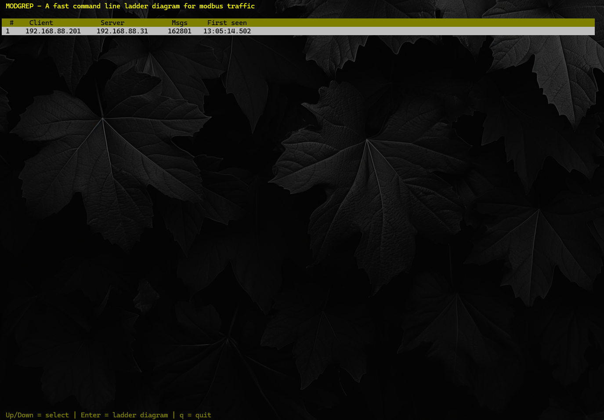
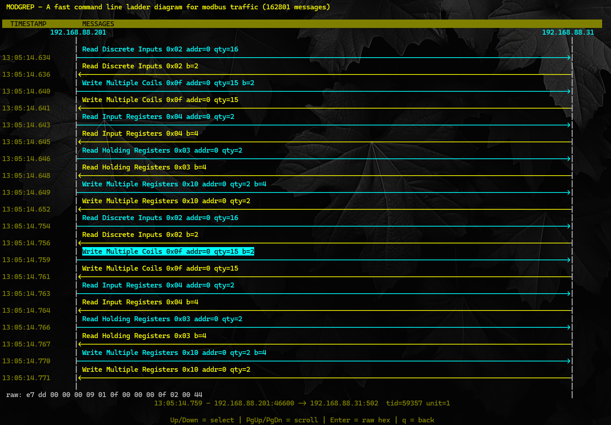

# modgrep

**modgrep** is a fast command-line MODBUS TCP traffic analyzer with an interactive ncurses ladder-diagram interface. It is inspired by [sngrep](https://github.com/irontec/sngrep).



*Start screen: after loading a capture file, modgrep shows the client and server IP addresses, the number of messages exchanged and the timestamp of the first message.*



*Ladder diagram: timestamps, client and server IPs, arrows showing the direction of each message with its description, and the raw hexadecimal payload in the footer.*

## Features

- Analyze MODBUS TCP traffic from PCAP files or a live network interface
- Interactive terminal user interface built with ncurses
- Ladder diagram for client/server MODBUS transactions
- Color-coded requests and responses
- Transaction ID, unit ID, latency and raw hex inspection
- Supports common MODBUS function codes

## Build

### Debian / Ubuntu / Kali Linux

```bash
sudo apt update
sudo apt install -y build-essential cmake git libpcap-dev libncurses-dev
git clone https://github.com/RodolfoCDSantos/modgrep.git
cd modgrep
cmake -S . -B build
cmake --build build
```

### Teltonika RUT950 / RUT955 (RutOS 7.x)

Prebuilt `.ipk` packages for `mips_24kc` are available in the [Releases](https://github.com/RodolfoCDSantos/modgrep/releases) page. See [docs/RUTOS_INSTALL.md](docs/RUTOS_INSTALL.md) for installation instructions.

## Usage

### Analyze a PCAP file

```bash
./build/modgrep -r capture.pcap
```

### Capture live traffic

```bash
sudo ./build/modgrep -i eth0
```

### Use a custom MODBUS TCP port

```bash
./build/modgrep -r capture.pcap -p 1502
```

### Apply a BPF filter

```bash
sudo ./build/modgrep -i eth0 -f "tcp port 502"
```

## Interface

The conversation list shows detected MODBUS TCP conversations. Select one and press `Enter` to open the ladder diagram.

- Cyan: MODBUS request from client to server
- Yellow: MODBUS response from server to client
- Red: MODBUS exception response
- `Enter`: show or hide the raw hexadecimal payload
- `Up/Down` or `j/k`: select a message
- `PgUp/PgDn`: scroll
- `q`: return or exit

## License

This project is released under the MIT License.

## Credits

modgrep is an independent implementation inspired by [sngrep](https://github.com/irontec/sngrep), developed by Irontec.

---

# modgrep (Português brasileiro)

**modgrep** é um analisador rápido de tráfego MODBUS TCP para linha de comando, com interface interativa em ncurses e diagrama de escada. É inspirado no [sngrep](https://github.com/irontec/sngrep).


*Tela inicial: ao carregar um arquivo de captura, o modgrep mostra os IPs do cliente e do servidor, a quantidade de mensagens trocadas e o timestamp da primeira mensagem.*


*Diagrama de escada: timestamps, IPs do cliente e do servidor, setas indicando a direção de cada mensagem com sua descrição e, no rodapé, o conteúdo hexadecimal da mensagem.*

## Recursos

- Analisa tráfego MODBUS TCP de arquivos PCAP ou de uma interface de rede em tempo real
- Interface de terminal interativa construída com ncurses
- Diagrama de escada para transações cliente/servidor MODBUS
- Requisições e respostas identificadas por cores
- Inspeção de Transaction ID, Unit ID, latência e conteúdo hexadecimal bruto
- Suporte às funções MODBUS mais comuns

## Compilação

### Debian / Ubuntu / Kali Linux

```bash
sudo apt update
sudo apt install -y build-essential cmake git libpcap-dev libncurses-dev
git clone https://github.com/RodolfoCDSantos/modgrep.git
cd modgrep
cmake -S . -B build
cmake --build build
```

### Teltonika RUT950 / RUT955 (RutOS 7.x)

Pacotes `.ipk` pré-compilados para `mips_24kc` estão disponíveis na página de [Releases](https://github.com/RodolfoCDSantos/modgrep/releases). Consulte [docs/RUTOS_INSTALL.md](docs/RUTOS_INSTALL.md) para as instruções de instalação.

## Uso

### Analisar um arquivo PCAP

```bash
./build/modgrep -r captura.pcap
```

### Capturar tráfego em tempo real

```bash
sudo ./build/modgrep -i eth0
```

### Usar uma porta MODBUS TCP personalizada

```bash
./build/modgrep -r captura.pcap -p 1502
```

### Aplicar um filtro BPF

```bash
sudo ./build/modgrep -i eth0 -f "tcp port 502"
```

## Interface

A lista de conversas mostra as conversas MODBUS TCP detectadas. Selecione uma conversa e pressione `Enter` para abrir o diagrama de escada.

- Ciano: requisição MODBUS do cliente para o servidor
- Amarelo: resposta MODBUS do servidor para o cliente
- Vermelho: resposta de exceção MODBUS
- `Enter`: mostra ou oculta o conteúdo hexadecimal bruto
- `Cima/Baixo` ou `j/k`: seleciona uma mensagem
- `PgUp/PgDn`: rola a tela
- `q`: volta ou sai

## Licença

Este projeto é distribuído sob a licença MIT.

## Créditos

O modgrep é uma implementação independente inspirada no [sngrep](https://github.com/irontec/sngrep), desenvolvido pela Irontec.
